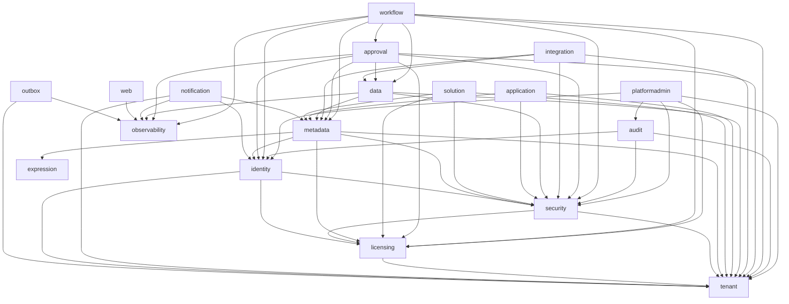

# Logical modules and allowed dependencies

The authoritative declaration is each module's `package-info.java`
(`platform-app/src/main/java/app/platform/<module>/package-info.java`); the architecture tests fail the build if
code disagrees with it. This table must be updated in the same pull request as any change to those files
(and the change recorded in [ADR-0001](adr/0001-modular-monolith.md)).

Module identifiers are package names, so the platform-admin module is `platformadmin`.

| Module | Responsibility | First built | May depend on (besides `sharedkernel`) |
|--------|----------------|-------------|----------------------------------------|
| `sharedkernel` | Identifiers and cross-cutting interfaces (secrets store, event publisher and handler contracts; since S15A the `ReferenceDirectory` through which the record store asks the module that owns an object whether an identifier is one of its records, [ADR-0099](adr/0099-the-reference-directory-links-to-objects-a-platform-module-owns.md); since S19 the `ReferenceLabels` contract (the names of the records a module owns, for a screen that shows a link: the different contract ADR-0107 named, [ADR-0129](adr/0129-record-screens-the-members-description-names-and-validation.md)); since S18 the `ObjectStore` contract of the S3-compatible object store, moved here from `data` so that `metadata` can keep custom-page scripts in it too without a `metadata -> data` edge, [ADR-0127](adr/0127-custom-page-scripts-and-the-sandboxed-iframe.md)). Open to all. Separate Maven module. **Since FA1:** `ShippedApplications` with `ShippedApplicationView` and `ShippedEntryView` (the platform-shipped applications the menu merges; implemented by `solution`) and `FeatureNotes` (the words shown before a plan feature is taken away) ([ADR-0181](adr/0181-the-solution-framework.md)). **Since S23:** `ParkedEvents` (list and put back the dead events of the current organization, implemented by `outbox`) and the mail template `RECORD_NOTICE` ([ADR-0143](adr/0143-dead-letters-parked-events-and-redrive.md), [ADR-0138](adr/0138-workflow-actions-and-the-shape-of-their-settings.md)). **Since S24:** `RecordLocks` (is a record locked by a pending approval; implemented by `approval`, asked by `data` alone) and `ApprovalUsage` (are requests waiting under a process or an object; asked by `metadata`), and the mail template `APPROVAL_REQUEST` ([ADR-0148](adr/0148-record-locking-while-an-approval-is-pending.md), [ADR-0145](adr/0145-the-approval-model-processes-versions-instances-and-states.md)). **Since S25:** `Notices` with `NoticeKind` and `NoticeRequest` (make an in-app notice for a member of the current organization; implemented by `notification`), `NoticeText` (the pure rules of a notice text, used by `metadata` at save and by `notification` at read), `AutomationHealthSource` with `HealthSection` and `HealthItem` (a module's counts for the failure view), and the mail templates `APPROVAL_REMINDER` and `TRIAL_NOTICE` ([ADR-0154](adr/0154-the-notification-model-in-app-notices.md), [ADR-0158](adr/0158-module-edges-and-contracts-of-sprint-25.md)). **Since FA2A:** `NumberSeriesDeclarations` with `NumberSeriesDeclaration` (the number series a shipped solution declares; implemented by `solution`, collected and checked by `data`) ([ADR-0184](adr/0184-number-series-declaration-formats-and-counters.md)). | S0 | nothing |
| `tenant` | Organizations, tenant lifecycle, tenant context, hostname resolution (ADR-0014, ADR-0017), and since S16 the limits one organization is held to (`OrganizationLimits`: requests in progress, statement time; ADR-0108) **Since S25:** the system scope `approval_timers`, which admits select and update on `approval_step_timer` and no other table, entered only by the approval timer ([ADR-0158](adr/0158-module-edges-and-contracts-of-sprint-25.md)). | S2, S16, S25 | nothing |
| `identity` | (Since S15A it answers the reference directory for the `User` object: an identifier is a user when the person has an active membership of the organization, [ADR-0099](adr/0099-the-reference-directory-links-to-objects-a-platform-module-owns.md).) Users, credentials, sign-in, sessions and tokens, the provider abstraction (S3: [ADR-0019](adr/0019-authentication-implementation.md) to [ADR-0021](adr/0021-brute-force-protection-and-rate-limits.md)); memberships, invitations and organization switching (S5: [ADR-0026](adr/0026-membership-lifecycle-and-the-administrator-marker.md) to [ADR-0029](adr/0029-switching-organizations.md)); platform roles, administrative sessions and the first-administrator invitation (S6: [ADR-0030](adr/0030-platform-roles-and-the-first-platform-administrator.md), [ADR-0036](adr/0036-administrative-sessions.md), [ADR-0037](adr/0037-provisioning-an-organization-for-a-client.md)); the abilities a member holds decide every administrative action, and invitations create members with a profile and role (S7: [ADR-0043](adr/0043-replacing-the-administrator-marker.md)); since S18 the short-lived, narrowly scoped access token a custom page's script uses (`embedded_token`, bound to the sign-in grant, the one `EmbeddedAccessPolicy` allow-list, the one `EmbeddedCors` rule for the origin `null`), [ADR-0127](adr/0127-custom-page-scripts-and-the-sandboxed-iframe.md) | S3 | tenant, licensing, security |
| `licensing` | Plans, licence types, pools and assignments, subscriptions and trials, feature entitlements (S6: [ADR-0031](adr/0031-where-the-platform-tables-live-and-how-an-organization-is-reached.md) to [ADR-0034](adr/0034-feature-entitlements.md)). **Depends on `tenant` only**: the identity module calls it, so a licence goes back to the pool in the transaction that deactivates a member **Since S25:** `Subscriptions.overTrials`, `trialStagesDone` and `markTrialStage` for the end of a trial, with the platform-level markers `subscription_notice` (V057) ([ADR-0162](adr/0162-the-end-of-a-trial.md)); no new edge. | S6, S25 | tenant |
| `security` | Abilities, profiles, access policies, individual grants, the role hierarchy, the effective-permission calculator and the one read contract `Permissions` (S7: [ADR-0039](adr/0039-abilities-profiles-access-policies-and-individual-grants.md) to [ADR-0045](adr/0045-system-profiles-seeding-backfill-and-licence-consequences.md)); public groups, object and field permissions, the permission decision API `Decisions`, the object catalogue contract `ObjectCatalog` (the metadata module provides the implementation since S10) and the contract `DataPermissionCleanup` that ends the permissions of a removed object or field and the group read contract `GroupMembers` (S8: [ADR-0046](adr/0046-licence-kinds-and-the-licence-rule-of-access-policies.md) to [ADR-0050](adr/0050-the-permission-decision-api.md)). **Since S17:** record-level security: the role hierarchy, organization-wide defaults and sharing rules (tables `object_sharing_setting`, `sharing_rule`, `member_access.user_id`), published as the closed description `RecordSecurity` / `RecordAccess` / `Admission` that `data` evaluates; the contracts `RecordMatcher` and `SharingCriterionChecker` that `data` implements (the same inversion as `ObjectCatalog`) and `SharingRules` for the dependency graph; the abilities `sharing.manage` and, since S19, `views.share` ([ADR-0130](adr/0130-saved-list-views.md)) ([ADR-0115](adr/0115-the-record-access-model-and-how-it-reaches-a-statement.md) to [ADR-0118](adr/0118-view-all-modify-all-and-one-evaluation.md)); **no new dependency edge**. **Depends on `licensing` and `tenant` only**: identity asks it, so a member's access is created, changed and released in the transaction of the membership change **Since S23:** the ability `workflows.replay` (replay, bulk replay and putting back parked events; separate from `workflows.manage`). **Since S24:** the abilities `approvals.view`, `approvals.manage`, `approvals.view-all` and `approvals.override-lock`, and `ApproverDirectory`, the one read of who holds a profile, a role or a public group, asked by `approval` alone (an architecture test) ([ADR-0146](adr/0146-approver-resolution.md), [ADR-0152](adr/0152-entitlement-abilities-visibility-and-telling-the-approver.md)); no new edge. **Since S25:** the ability `automation.view` (the failure view) and `MemberAccess.administrators()` (the users who hold the Organization administrator profile, for the trial notice); no new edge. **Since FA1:** `ShippedAccessPolicies` (the access policies a solution ships, rows marked `managed_by`, made in the organization's own context and guarded by the database), the flag `retainRecords` on `ObjectCatalog.ObjectInfo` (the decision API never allows delete on such an object; the editor refuses the right), and the endpoints refuse to change or remove a shipped policy ([ADR-0181](adr/0181-the-solution-framework.md)); no new edge. **Since FA2A:** the ability `field-values.add` (add one value to a picklist whose list the organization owns, while filling in a record) ([ADR-0182](adr/0182-the-organizations-own-list-of-a-platform-picklist.md)); no new edge. **Since FA2B:** the typed grantee of a share (`Grantee`: a user, a group, a role, or a role with the roles below it; `Admission.SharedWith` holds the pairs a member is addressed by, built from their groups, own role and role chain), the contract `ShareTargets` (the names of the roles and groups a record can be shared with, used by `data`) and the contract `GranteeRemovals` (told in the transaction that removes a role or group, implemented by `data`, the same inversion as `RecordMatcher`) ([ADR-0185](adr/0185-shares-to-roles-the-typed-grantee-and-the-choice-of-roles-and-groups.md)); no new edge. | S7 | tenant, licensing |
| `metadata` | Object and field definitions: the standard ones (read from definition files, protected, [ADR-0059](adr/0059-standard-metadata-in-definition-files.md)) and the organization's own (tenant-scoped tables), the field types and their rules, the metadata API and the object catalogue cache; it provides the `ObjectCatalog` of `security` (S10: [ADR-0058](adr/0058-object-and-field-definitions.md) to [ADR-0062](adr/0062-removing-objects-and-fields.md), [metadata-guide.md](metadata-guide.md)). Since S11: relationships read from the fields, record types, the dependency graph, change sets (draft, check, preview, publish), releases and rollback ([ADR-0063](adr/0063-relationships.md) to [ADR-0068](adr/0068-the-publish-ability-and-changes-made-at-once.md)); no new dependency edge (it asks `security.Permissions` for the ability to publish). Since S12: page layouts, record pages, applications with their navigation, layout assignments and the closed visibility rules, all checked against a JSON schema and all inside the same lifecycle ([ADR-0069](adr/0069-layouts-record-pages-applications-and-where-they-live.md) to [ADR-0072](adr/0072-the-dependency-graph-learns-layouts-pages-and-applications.md), [ADR-0074](adr/0074-definitions-the-version-counter-and-the-cache.md)); still no new dependency edge (it asks `security.MemberAccess` for the profile identifiers and names). Since S13: formula fields that are checked and are edges of the dependency graph, validation rules, the check and try-it endpoints, the runtime read contract `MetadataResolver` with the compiled rules and formulas kept with the catalogue, and the publish event that warms the cache ([ADR-0077](adr/0077-formula-fields-are-checked-and-are-edges-of-the-graph.md) to [ADR-0080](adr/0080-the-metadata-runtime-compiled-artefacts-and-the-publish-event.md)); **new edge `metadata -> expression`**. Since S15A: record type assignments (which profiles may use which record type, the profile's default type), published metadata through the same change-set lifecycle, with `Metadata.recordTypesFor` and `Metadata.defaultRecordTypeFor` as the questions the data engine asks ([ADR-0098](adr/0098-record-type-assignments-which-profiles-may-use-which-record-type.md)); no new edge. Since S17: the dependency graph knows sharing rules (`SharingDependencies`, reading `security.SharingRules`) and the field flags `externalId` and `searchable` (V047); no new edge. Since S18: `Tab` (reusable, independent of one application; today one kind, `CUSTOM`) and `CustomPage` (a label and an uploaded script, identified by its content, with an inert reference for server-side code that nothing reads, decision D6) through the same lifecycle, two new dependency edges (a tab needs its custom page, an application's `TAB` item needs its tab), and the upload endpoint for a script; no new edge ([ADR-0127](adr/0127-custom-page-scripts-and-the-sandboxed-iframe.md), [ADR-0128](adr/0128-tabs-and-security-aware-navigation.md)). Since S20: record page assignments (which record page an object uses for a profile and a record type, through the same lifecycle) and the question `Metadata.recordPageFor` ([ADR-0131](adr/0131-record-pages-assignment-descriptor-and-the-record-screen.md)); no new edge. **Since S22:** workflow definitions and their immutable versions (`workflow`, `workflow_version`, V053) through the same lifecycle (three change kinds, a dependency contributor, `Metadata.workflows`), the compiled conditions the runtime reads (`MetadataResolver.workflows` and `workflowVersion`), the optional contract `RecordSelectionChecker` that `data` implements, and the clean-up of old versions; **new edge `metadata -> licensing`** (does the plan have the feature `workflows`; `licensing` depends on `tenant` only, so no cycle) ([ADR-0136](adr/0136-workflow-definitions-versions-and-lifecycle.md)) **Since S24:** approval processes and their immutable versions (`approval_process`, `approval_process_version`, V055) through the same lifecycle (three change kinds, a dependency contributor, `Metadata.approvalProcesses`, the compiled entry criteria in `MetadataResolver`), the workflow trigger `APPROVAL_OUTCOME` and the action `START_APPROVAL` as edges of the graph; removing a process or an object with waiting requests is refused through `ApprovalUsage`; no new edge ([ADR-0145](adr/0145-the-approval-model-processes-versions-instances-and-states.md), [ADR-0150](adr/0150-start-approval-as-a-workflow-action.md)). **Since S25:** notification templates (`notification_template`, V056) through the same lifecycle (three change kinds, a dependency contributor, `NotificationTemplates` as the live read), the workflow triggers `BEFORE_CREATE` and `BEFORE_UPDATE` with the action `SET_FIELDS`, the action `NOTIFY`, and the optional `remindAfterHours` and `escalateAfterHours` on the version of an approval process; no new edge ([ADR-0155](adr/0155-the-text-of-notices-and-mails.md), [ADR-0159](adr/0159-reminders-escalation-and-the-approval-timer.md), [ADR-0160](adr/0160-before-save-automation.md), [ADR-0161](adr/0161-the-notify-action-and-administrator-text-for-mail.md)). **Since FA1:** the object attributes `requiresFeature` (an organization without the plan feature does not have the object: asked when the object is looked up, never part of the snapshot) and `retainRecords`, the shipped object files `solutions/*/objects/*.yml` read like the standard ones, and the public contract `PlatformObjects` (the platform's own objects, with no tenant) ([ADR-0181](adr/0181-the-solution-framework.md)); no new edge. **Since FA2A:** dependent picklists (the rule inside the picklist configuration, `PicklistDependencies` as a dependency-graph contributor, the report note "N records hold a pair that is no longer allowed"), the field attributes `organizationValues`, `codeValues` and `platformWritten`, and the organization's own list of a platform picklist (`organization_field_values`, V061, merged into the snapshot; `OrganizationValues`, the endpoint `POST .../fields/{field}/values`) ([ADR-0177](adr/0177-dependent-picklists.md), [ADR-0182](adr/0182-the-organizations-own-list-of-a-platform-picklist.md), [ADR-0183](adr/0183-a-field-only-the-platform-writes.md)); no new edge. | S10, S11, S12, S13, S22, S24, S25 | tenant, security, identity, expression, licensing |
| `expression` | The one small language of formulas and validation rules: a hand-written parser into a sealed tree, a type checker against a map of field types, an evaluator over a map of values, a fixed library of functions, bounded in length, parts, nesting, steps, text size and time. **Pure logic, depends on nothing of the platform** (no database, no Spring, no I/O; an architecture test keeps it that way), so `metadata` (now) and `integration` mapping (S28) can use it (`workflow` receives compiled conditions through `metadata` and needs no edge: [ADR-0136](adr/0136-workflow-definitions-versions-and-lifecycle.md)) ([ADR-0076](adr/0076-the-expression-engine-and-its-language.md), [ADR-0081](adr/0081-security-review-of-the-expression-engine.md)) | S13 | nothing |
| `data` | Tenant business records. Since S14: the record store (`object_record`, the values as JSON with reserved typed copies for indexes), the public contract `Records` (create, read, change with a version, delete, restore, remove for good, a minimal list, the recycle bin; one gate for every call) and `StorageStrategy` (where records are kept; the generic JSON store is the one implementation), the endpoints under `/api/v1/objects/{object}/records` and `/recycle-bin`, the clean-up of the recycle bin, and the answer to `ObjectUsage` (an object or field in use is not removed) ([ADR-0084](adr/0084-the-record-store.md) to [ADR-0090](adr/0090-the-answer-to-object-usage.md); the decision is gate G1, [ADR-0082](adr/0082-storage-benchmark-specification-gate-g1.md) and [ADR-0083](adr/0083-storage-benchmark-result-gate-g1.md)). Queries (S16) and record-level security (S17) follow. **Since S15:** the write pipeline between the gate and the storage (shape, record type, field permission, type, required, relationship, validation rules, formulas; defaults and auto-numbers on create), field security on writes and reads (a field the member may not read is absent), record types on records, formulas stored on write, and the counter of auto-numbers (`auto_number_counter`, V037) ([ADR-0091](adr/0091-the-write-pipeline-and-its-order.md) to [ADR-0097](adr/0097-links-between-records-on-write.md)). **Since S15A:** the record-type stage asks the member's profile (`MemberAccess.profileOf`, no new edge) which record types they may use ([ADR-0098](adr/0098-record-type-assignments-which-profiles-may-use-which-record-type.md)), and a lookup to a `User` is answered by the reference directory of the shared kernel, implemented by `identity` ([ADR-0099](adr/0099-the-reference-directory-links-to-objects-a-platform-module-owns.md)); still no new dependency edge. **New edge `data -> observability`** (a validation rule that cannot be evaluated is reported to the error tracking); the edge `data -> expression` that the plan allowed is **not** added, because the compiled rules and formulas arrive through `metadata.MetadataResolver` **Since S16:** the query engine (`Records.query`, the closed model `RecordQuery`, the stages of ADR-0100, the seam `RecordVisibility` for record-level security), the index policy (`field_slot`, 22 typed slots, `IndexPolicy`, `IndexBackfill`, ADR-0101/0102), record links (`record_link`, `link_index`, delete behaviours, the junction: `RecordLinks`, `RecordRemoval`, `LinkBackfill`, ADR-0106), lookup resolution (ADR-0107) and the index status read; **no new module edge** (the event `metadata.published` is handled by name, the limits live in `tenant`). **Since S17:** record-level security in every read path (`AdmissionPlans`, `RecordVisibility`, `DataRecordMatcher`), explicit shares and the owner (`record_share`, `RecordSharing`), files in an S3-compatible object store (`ObjectStore`, `FileService`, `FileCleanup`, ADR-0120/0121), bulk (`BulkRecords`, ADR-0122), CSV import jobs (`ImportRunner`, ADR-0123) and search (`search_term`, `SearchEngine`, ADR-0124); **no new module edge**. **Since S19:** the member's own description of an object for the record screens (`ObjectForms`, `GET .../form`: the fields they may read and edit, the comparisons each takes, the layout, the record types, the title field), the names behind links and the pickers (`LookupService`, `POST .../lookups/{field}/labels|options`, which asks `ReferenceLabels` for a platform-owned object and the record store for an ordinary one), the preview of a save (`RecordCheck`, `POST .../records/validate`: the real pipeline, undone) and saved list views (`list_view`, V051, `ListViews`) ([ADR-0129](adr/0129-record-screens-the-members-description-names-and-validation.md), [ADR-0130](adr/0130-saved-list-views.md)); **no new module edge**. **Since S20:** the member's own record page (`RecordPageViews`, `GET .../record-page`: the page resolved for their profile and the record's type, filtered to what they may reach, the platform's own page when none is configured) and the layout a page names for the form (`GET .../form?layout=`) ([ADR-0131](adr/0131-record-pages-assignment-descriptor-and-the-record-screen.md)); **no new module edge**. **Since S22:** `BackgroundRecords`, the platform's own reads for background work (one record including the recycle bin, the engine values of a record, a page of records through the query engine's own stages) and the `RecordSelectionChecker` of the metadata module; nothing is added to the write path and `data` knows nothing of `workflow` ([ADR-0137](adr/0137-executions-asynchronous-after-commit-and-what-they-keep.md)); **no new module edge**. **Since S23:** `BackgroundWrites`, the one place where background work changes a record: the same `WritePipeline` in a mode with no member (no gate, no permission stages), the same storage, links, search, audit and event, a stable `BackgroundWriteException` reason for a refusal, the chain in the event; reachable only from `workflow` (architecture test) ([ADR-0139](adr/0139-background-writes-the-one-reviewed-path.md)); **no new module edge** **Since S24:** the lock of a record under approval: one `RecordLockGuard` asked by every path that changes a record (update, delete, restore, purge, bulk, import, the owner, files, `BackgroundWrites`, a cascade or a pointer clearing that reaches a locked record) before the write, after taking the row lock of the record; the member who holds `approvals.override-lock` passes and is audited; `RecordTitles` (titles for the inbox) and `BackgroundRecords.findAndHold`; `BackgroundWrites` is now reachable from `workflow` and `approval` (architecture test); **no new module edge** (the lock is the shared-kernel contract `RecordLocks`) ([ADR-0148](adr/0148-record-locking-while-an-approval-is-pending.md), [ADR-0149](adr/0149-outcome-updates-and-the-events-that-carry-the-rest.md)). **Since S25:** the stage `before save` of the write pipeline (between type and required): the before-save automations of an object set fields of the record being saved, bounded and name-ordered (`BeforeSave`), with a kill switch; **no new module edge** ([ADR-0160](adr/0160-before-save-automation.md)). **Since FA1:** the retained-object rule: `RecordGate` refuses every route that removes, restores over or purges a record of an object whose records are kept, the recycle-bin job skips them, and `RetainedObjects` keeps the database list `retained_object` that two triggers on `object_record` read ([ADR-0181](adr/0181-the-solution-framework.md)); no new edge. **Since FA2A:** the pipeline stage `dependent` (`DependentValues`, between `relationship` and `unique`), the description of the dependency and of what a member may add in `ObjectForms`, a field only the platform writes refused for every member by `FieldSecurity`, and `NumberSeries` (a public contract: the numbers of the series a solution declares; `number_series_counter`, V062; no endpoint) ([ADR-0177](adr/0177-dependent-picklists.md), [ADR-0183](adr/0183-a-field-only-the-platform-writes.md), [ADR-0184](adr/0184-number-series-declaration-formats-and-counters.md)); **no new module edge** (the declarations arrive through the shared-kernel contract). **Since FA2B:** explicit shares to a role and to a role with the roles below it (`record_share`, V063; the statement matches a share on its kind and identifier together), the read of the roles and groups a record can be shared with (`GET .../records/{id}/share-targets`), and the end of the shares to a removed role or group (`DataGranteeRemovals`) ([ADR-0185](adr/0185-shares-to-roles-the-typed-grantee-and-the-choice-of-roles-and-groups.md)); **no new module edge**. | S14, S15, S16, S17, S19, S20, S22, S23, S24, S25 | tenant, metadata, security, observability |
| `application` | The member's side of applications and navigation: which applications a member may use and what their menu shows, resolved by the server (S12: [ADR-0073](adr/0073-applications-navigation-and-the-members-menu.md)). The definitions themselves are metadata ([ADR-0069](adr/0069-layouts-record-pages-applications-and-where-they-live.md)). Since S18: an entry is listed only when the member may actually read what it opens (`Decisions.accessToAll`), an empty heading or application is dropped, and a `TAB` entry of kind `CUSTOM` is served its script only when some application the member sees still lists it ([ADR-0128](adr/0128-tabs-and-security-aware-navigation.md)); no new edge **Since FA1:** the menu merges the applications of the shared-kernel contract `ShippedApplications` through an optional bean and judges their entries by read permission (new entry type `PLATFORM`); **no edge to `solution`** ([ADR-0181](adr/0181-the-solution-framework.md)). | S12 | tenant, metadata, security |
| `notification` | E-mail (S4: queue, relay with retries, SMTP, texts; [ADR-0024](adr/0024-mail-queue-and-notification-v0.md)). **Since S23:** the mail `RECORD_NOTICE` that a workflow asks for (facts only; the link to the record is built when it is sent, on the organization's own host) ([ADR-0138](adr/0138-workflow-actions-and-the-shape-of-their-settings.md)); no new edge. **Since S24:** the mail `APPROVAL_REQUEST` (facts only, no title; the link opens the inbox); no new edge ([ADR-0152](adr/0152-entitlement-abilities-visibility-and-telling-the-approver.md)). **Since S25:** in-app notices (`notification`, V056) created through the shared-kernel `Notices` contract and read, counted and marked read by their recipient; per-person switches with a floor (`notification_preference`); the words of a notice built at read time from the platform's text or an administrator's template; the retention of notices; the mails `APPROVAL_REMINDER` and `TRIAL_NOTICE` and the administrator's text for every mail; the mail section of the failure view. **New edge `notification -> metadata`** (the template text and the labels of objects, processes and workflows; `metadata` knows nothing of `notification`) ([ADR-0154](adr/0154-the-notification-model-in-app-notices.md) to [ADR-0157](adr/0157-asynchronous-delivery-and-once.md)). | S4, S25 | tenant, identity, metadata, observability |
| `approval` | The approval engine (S24): processes and immutable versions (published metadata in `metadata`), requests that are pinned to the version they started under, steps, tasks and an append-only history (V055), the approver rules resolved when a step becomes active, approve, reject, recall, reassign, assign, cancel and apply-the-outcome-again, delegation, the record lock (a pending request **is** the lock: the shared-kernel contract `RecordLocks` that `data` asks through its one `RecordLockGuard`), outcome updates made through `data.BackgroundWrites` in a savepoint, the events `approval.*` and the mail `APPROVAL_REQUEST` ([ADR-0145](adr/0145-the-approval-model-processes-versions-instances-and-states.md) to [ADR-0153](adr/0153-what-sprint-24-leaves-out-and-why.md)). A workflow reaches it through its public interface (`Approvals.startByPlatform`, the action `START_APPROVAL`) and follows its end through the events (the trigger `APPROVAL_OUTCOME`); `approval` never depends on `workflow` **Since S25:** reminders, one escalation to the fallback approver and the mark `overdue` by the approval timer (`approval_step_timer`, `approval_reminder`, V057; the only class besides its store that enters the system scope `approval_timers`), the notices of tasks, reminders and decisions through `Notices`, and the approval section of the failure view; **new edge `approval -> observability`** (a step the timer could not handle is reported to the error tracking) ([ADR-0159](adr/0159-reminders-escalation-and-the-approval-timer.md)). | S24, S25 | tenant, metadata, security, data, identity, licensing, observability |
| `integration` | Connector framework and adapters; the only module that knows external systems | S26 | tenant, metadata, security, data |
| `workflow` | The runtime of automation defined as data (S22): the handler that turns a record event into executions, the dispatcher (the one place that enters the system scope `workflow_dispatch`, [ADR-0135](adr/0135-the-workflow-dispatch-system-scope.md)) that claims queued executions and due schedules of every organization and runs each in the organization's own context, the scheduler of timed workflows ([ADR-0134](adr/0134-the-scheduler-of-timed-workflows-decision-d9.md)), the closed seam of actions (`PUBLISH_EVENT`; since S23 also `UPDATE_RECORD`, `CREATE_RECORD` and `SEND_EMAIL`), the history of executions and its endpoints, retention ([ADR-0133](adr/0133-event-processing-stays-on-the-outbox-decision-d3-final.md), [ADR-0137](adr/0137-executions-asynchronous-after-commit-and-what-they-keep.md)). The definitions, versions and lifecycle are metadata and live in `metadata` ([ADR-0136](adr/0136-workflow-definitions-versions-and-lifecycle.md)). `approval`, `notification` and `integration` are added by the sprints that need them. **Since S23:** the actions that change the world (a write goes through `data.BackgroundWrites`, a mail through the shared-kernel `MailQueue`), retries with a backoff that waits in the row, the dead letter, replay and cancel, the chain that stops a workflow from starting itself, and the list and redrive of parked events through the shared-kernel `ParkedEvents` ([ADR-0138](adr/0138-workflow-actions-and-the-shape-of-their-settings.md) to [ADR-0144](adr/0144-what-sprint-23-leaves-out-and-why.md)); **no new module edge** **Since S24:** the action `START_APPROVAL` (fire and forget; stable reasons) and the trigger `APPROVAL_OUTCOME` (the events `approval.approved|rejected|recalled`); **new edge `workflow -> approval`** (the public interface `Approvals` only; `approval` never depends on `workflow`) ([ADR-0150](adr/0150-start-approval-as-a-workflow-action.md)). **Since S25:** the actions `NOTIFY` and `SET_FIELDS` (the latter only for the before-save triggers, never run by the dispatcher), the fair share of the claim (round robin over organizations with a cap per look, [ADR-0164](adr/0164-a-fair-share-of-the-queue.md)), the queue-age gauge by hash bucket, the workflow section of the failure view and its endpoint `GET /api/v1/automation/health`; no new edge ([ADR-0161](adr/0161-the-notify-action-and-administrator-text-for-mail.md), [ADR-0163](adr/0163-observability-of-automation-and-the-failure-view.md)). | S22, S23, S24, S25 | tenant, metadata, security, data, identity, licensing, observability, approval |
| `audit` | Append-only audit records (audit v1, S9: the `AuditRecorder` contract is in `sharedkernel`; the module writes the platform-level table `audit_record` with a read policy by audience, consumes the tenant lifecycle events of the outbox, serves the audit viewer through `AuditEvents` and runs the retention of old records; [ADR-0022](adr/0022-platform-level-identity-tables-and-audit-v0.md), [ADR-0054](adr/0054-audit-v1-record-source-and-read-model.md), [ADR-0055](adr/0055-audit-retention-and-the-append-only-door.md), [ADR-0056](adr/0056-the-audit-viewer.md)) | S9 (v0 in S3) | identity, security, tenant |
| `solution` | The platform-shipped solutions (Functional track FA1): loads and checks the read-only bundles `solutions/<key>/solution.yml` at start; answers the shared-kernel contracts `ShippedApplications` (a computed application, listed only while the organization has the solution's plan feature, no row written for it) and `FeatureNotes` (what taking the feature away does, for the console); keeps the solution's access policies in step in the organization's own context (`ShippedAccessPolicies` of `security`, the first menu request after the feature is gained). Generic: no word of any one solution is in its code. The objects of a bundle are read by `metadata` ([ADR-0181](adr/0181-the-solution-framework.md), [ADR-0175](adr/0175-how-a-platform-shipped-application-exists.md)). **New module; edges `solution -> tenant, licensing, metadata, security`; `application` has none to it** **Since FA2A:** reads `solutions/<key>/numbering.yml` and answers the shared-kernel contract `NumberSeriesDeclarations` (a series must number an object its own solution brings) ([ADR-0184](adr/0184-number-series-declaration-formats-and-counters.md)); no new edge. | FA1 | tenant, licensing, metadata, security |
| `observability` | Request correlation, error tracking hook, database correlation stamp (infrastructure); `data` reports a rule that cannot be evaluated through it since S15 | S1 | nothing |
| `outbox` | Transactional outbox, polling relay, idempotent consumer base (infrastructure, ADR-0016). Other modules use the event contracts of `sharedkernel`, never this module **Since S23:** it implements `ParkedEvents` in the organization's own context, so the dead letters of the workflow consumers can be listed and put back without a system scope ([ADR-0143](adr/0143-dead-letters-parked-events-and-redrive.md)). | S2 | tenant, observability |
| `web` | HTTP conventions: error model handling, paging binding, OpenAPI, platform status endpoint (infrastructure) | S1 | observability |
| `platformadmin` | The platform console: organizations, plans, platform people, sessions, provisioning, lifecycle by platform administrators ([ADR-0037](adr/0037-provisioning-an-organization-for-a-client.md), [ADR-0038](adr/0038-organization-lifecycle-by-platform-administrators.md)) and controlled support access with its one enforcement point ([ADR-0035](adr/0035-controlled-support-access.md)); separate from tenant administration **Since S25:** the end of a trial (`TrialEndJob`: warnings, then the existing suspension; never deletes, [ADR-0162](adr/0162-the-end-of-a-trial.md)) and the console's failure view `GET /api/v1/platform/automation/health` ([ADR-0163](adr/0163-observability-of-automation-and-the-failure-view.md)); no new edge. | S6, S25 | tenant, identity, licensing, security, audit |

## Rules

1. Another module may use only the types in a module's root package. Sub-packages are internal.
2. No module reads or writes another module's tables.
3. Cross-module reactions use events (the outbox of Sprint 2), not direct calls "backwards" up the graph.
   Example: modules publish events through `EventPublisher` and `audit` consumes them with an `EventHandler` bean;
   both interfaces are in `sharedkernel`, so neither side depends on `outbox`. `audit` reads from `identity`,
   `security` and `tenant` only to serve its viewer (the one question "may this member administer", the ability,
   the tenant context); none of them depends on `audit` (they write through the contract in `sharedkernel`).
4. Only `integration` may reference `app.platform.integration.adapter..`.
5. The graph must stay acyclic. A needed edge that would create a cycle means a missing event or a missing
   module, not a cycle.
6. Adding an edge: edit the module's `package-info.java`, edit this file, note it in the pull request.
7. `web`, `observability` and `outbox` are infrastructure modules ([ADR-0011](adr/0011-api-conventions.md),
   [ADR-0012](adr/0012-observability.md)). Business modules never depend on `web` (an architecture test enforces it):
   their controllers use the types of the API contract and throw `ApiException`. A business module that needs to
   report an unexpected error may depend on `observability` through the process in rule 6.
8. Sprint 6 changed one edge on purpose: `identity` depends on `licensing` (not the reverse), so that releasing a licence
   is part of the transaction that deactivates a member. `licensing` and `platformadmin` keep to their declared lists; the
   enforcement point of support access (`SupportAccess`) is a contract of the shared kernel, so a module that reads tenant
   data later can call it without depending on `platformadmin`.
9. Passwords, tokens and the authorization server stay inside `identity`: no other module may use the cryptography and
   authorization-server libraries (an architecture test enforces it), and no business module reads the caller from the security
   framework's static holder; it reads `TenantContexts` (the user is filled in from Sprint 3) or asks the identity module's public API.
10. Sprint 7 changed one more edge on purpose ([ADR-0041](adr/0041-where-the-access-tables-live-and-the-module-edge.md)):
    `security` no longer depends on `identity`; `identity` depends on `security` (graph: `identity → security → licensing →
    tenant`). `Administration` asks `Permissions` what a member may do, and acceptance, founding, deactivation and reactivation
    create, change and release a member's access in the transaction of the membership change. Security knows a member only by
    its identifier. A module that later needs to know what a member may do asks `Permissions` (and `Ability`), never a table.
